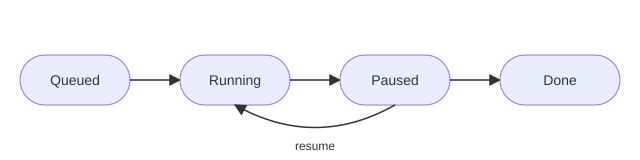

A backfill is a migration with no deadline and every opportunity to hurt production. Treat it like a service.

## A backfill has states



Every state is visible, and paused is a first-class state, not a crash.

::: warning
Never backfill faster than you can roll back. Throttle by the slowest downstream, not by your own throughput.
:::

```sql
UPDATE bookings
SET channel_id = legacy_channel_id
WHERE id BETWEEN $1 AND $2
  AND channel_id IS NULL;
```

| Setting | Value |
| --- | --- |
| Batch size | 500 rows |
| Pause between batches | 200 ms |
| Max replica lag | 2 s |
