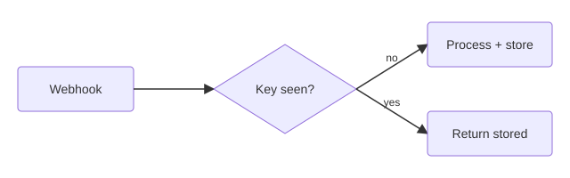

Webhooks arrive twice. Sometimes three times. The handler has to be fine with that.



## Store the result, not just the key

Returning the stored response makes a duplicate indistinguishable from the original, which is exactly what the sender expects.

```ts
const existing = await store.get(event.id)
if (existing) return existing
const result = await process(event)
await store.put(event.id, result)
return result
```

::: tradeoff
Storing every result costs space. Expire keys after the sender's retry window, not before.
:::
