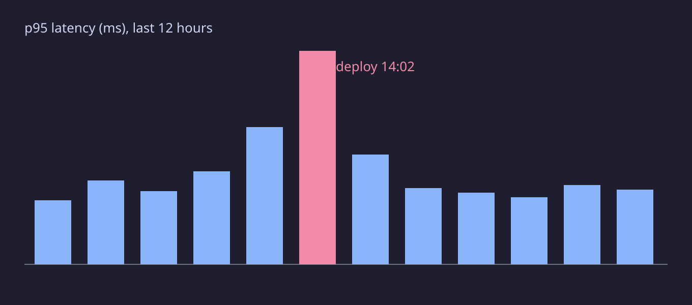

You cannot instrument everything on day one. Here is what I add first, and why.

## Metrics first, for the alert

A metric tells you something changed. It rarely tells you why.

::: note
The spike in this chart lined up with a deploy. Deploy markers on dashboards are the cheapest observability win there is.
:::

## Then traces, for the why

Traces turn "it is slow" into "it is slow in this call, for these accounts".

## Logs last, for the detail

::: warning
Logs without a request id are a diary, not evidence.
:::
