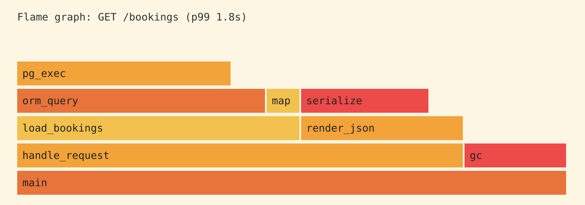

Flame graphs look like abstract art until somebody shows you the one rule: width is time.

## Read it bottom up

The bottom bar is the whole request. Every bar above it is a function called from the one below, and its width is the share of samples it was on the stack.

::: tip
Look for wide plateaus near the top: that is where time is spent doing work, not calling other work.
:::

Here the answer was boring: `pg_exec` under `orm_query`. A missing index, found in ten minutes.

| Before | After |
| --- | --- |
| p99 1.8s | p99 240ms |
| 31 queries | 4 queries |
