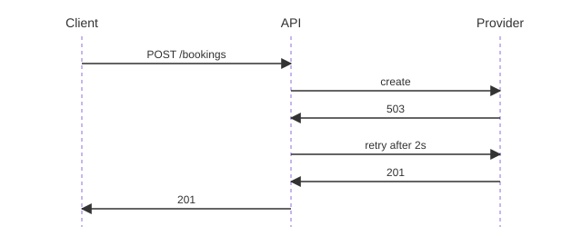

A retry is a promise about time. Somebody has to decide how long the caller is willing to wait, and that somebody is usually nobody.

## One request, two attempts



::: tradeoff
Retrying inside the API hides a provider blip from the client, but it also spends the client's timeout budget without telling them.
:::

## A budget, not a count

```ts
const deadline = Date.now() + 5_000
while (Date.now() < deadline) {
  const response = await provider.create(booking)
  if (response.ok) return response
  await sleep(backoff(attempt++))
}
```

::: tip
Log every retry with the attempt number. The day you need it, you will need it badly.
:::
