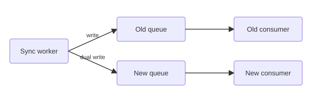

We moved a sync service that never stops running from one queue to another without a maintenance window. This is how, and what it cost.

## The shape of the move

The plan was dual writes, then dual reads, then a slow cut-over per account.



::: note
Dual writes double your failure modes for as long as they run. Put an end date on them before you start.
:::

## Cutting over

Each account moved behind a flag, checked by a comparison job that read both consumers' output.

```ts
export function consumerFor(account: Account): Consumer {
  return account.flags.newQueue ? newConsumer : oldConsumer
}
```

::: warning
The comparison job found three ordering bugs we would never have caught in staging.
:::

### What we would do differently

- Start the comparison job on day one, not week six.
- Move the noisiest accounts first, not last.
- Write the rollback runbook before the cut-over runbook.
